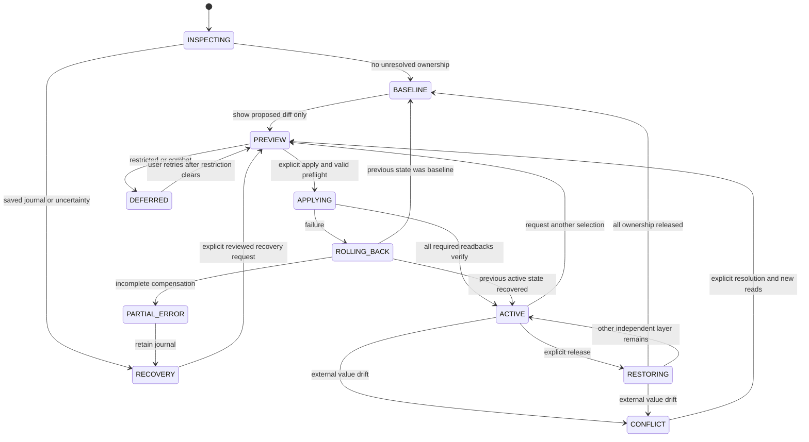

# Architecture proposal — Phase 00 review

**Status:** accepted in principle by Arctic's engineering review; implementation not authorized. **Date:** 2026-11-06. Evidence: [07](07-EVIDENCE-AND-DECISIONS.md); gates: [06](06-ROADMAP.md). All behavior below is a design requirement unless explicitly sourced. This review does not establish live-client behavior or authorize any setting writes.

## Boundaries and alternatives

Use a small standalone Lua addon with ordered TOC loading and one namespace table. A dependency framework is not justified for the one-key core; reconsider only if later requirements show a concrete benefit. Do not rely on a Retail version threshold, a newly invented Forever constant, legacy global aliases, stock Lua `require`, or beta compatibility shims. Gate the exact tested Forever build/interface and then the actual functions/flags. On a changed build, keep diagnostics available and writes disabled until revalidation.

Use the normal Settings API for discovery and a future custom canvas for the richer studio. A wholly custom window has greater input/accessibility maintenance cost. The wheel begins with click selection and explicit bindings; hold/release is a later experiment. Global CVar hooks and constant reassertion were rejected because they create taint/conflict risks and cannot establish ownership.

## Modules and contracts

| Module | Responsibility | Must not do |
|---|---|---|
| Bootstrap / Compatibility | Bind saved globals at the addon's own ADDON_LOADED; wait for client/CVars; capability snapshot and build gate | Write graphics at load, manufacture missing APIs |
| CVarCatalog | Build-scoped exact name, type, UI vs measured range, flags, risk, layer, dependencies, settle policy, evidence IDs | Treat guide values as defaults or infer support from a name |
| ProfileStore | Versioned, bounded data-only visual/quality definitions and preferences | Execute imports, retain arbitrary CVar keys |
| BaselineStore | Per-key originals, ownership epochs, unresolved recovery journal | Recapture an active preset as the user's baseline |
| Planner | Pure function: observed state + ownership + desired layer selection -> ordered plan or refusal | Call the client or silently drop required keys |
| CVarAdapter / Engine | Sole writer; preflight, exact writes, readback, verification, compensating rollback | Global resets, broad graphics preset writes, unbounded retries |
| Controller | Serialize requests, state transitions, transaction ID, conflict resolution | Let sliders/bindings bypass the engine |
| Effects / Audio | Apply optional presentation after successful commit; own only their frames/handles | Change global audio volume or imply CVar success with a cue |
| UI / Diagnostics | Plans, actual/desired/baseline values, failure reasons, recovery card, sanitized export | Export identities, private paths or whole SavedVariables tables |

Future TOC order: bootstrap namespace -> catalog/compatibility -> stores -> pure planner -> adapter/engine -> controller -> diagnostics -> optional effects/audio/UI. No files or TOC are created in Phase 00.

## Independent ownership

Each canonical key belongs to exactly one of visual, quality, or excluded domains. Validate profiles and reject cross-layer overlap. Presentation data is not a CVar. Desired state is the union of disjoint active deltas, not a full graphics snapshot to write back. Unknown keys never enter a plan.

Natural removes visual deltas; Quality Baseline removes quality deltas; Restore All removes both. The original raw string is captured just before first ownership after stable read-only preflight. It is not hardcoded to 45 or captured globally at startup. Successive switches retain that original. A new ownership epoch starts only after release and explicit reacquisition of a currently observed value.

Example: actual Brightness 52 -> NV 75 -> Natural returns 52. If a quality profile is active throughout, no quality key is touched. If an external change makes Brightness 63, a normal restore preserves 63 and reports that the original 52 was not restored.

## Per-key record and transaction record

Proposed saved schema: `schemaVersion`, addon version, tested client signature, preferences, profile definitions, and a recovery journal. For each journal key retain `originalRaw`, `lastVerifiedRaw`, intended value, layer, ownership epoch, state, evidence descriptor version and failure reason. Keep saved data bounded; no account/character identifiers in diagnostics or committed examples. Store a local character scope marker only if testing proves the CVar is character-scoped; do not assume all CVars have the same scope.

Keep an account-level journal for account/client-wide managed graphics; character A's active journal must not be overwritten by character B's login. New-character startup with unresolved records is recovery-only. A scope mismatch or unknown scope blocks automatic restoration. Do not attempt coordination across simultaneous clients; that configuration needs separate testing and is unsupported initially.

A transaction has `id`, prior committed selections/effects, ordered operations, **before-this-transaction values**, changed-key list and status. This is separate from the epoch baseline: a failed mode switch must return to the prior active state, not jump to the first baseline.

SavedVariables is an in-memory table until the client saves it. It is **not a durable write-ahead log**, and the addon cannot force a safe disk flush through a general filesystem API. Beta reports describe reload/logout persistence and a later fix (SRC-01/04); actual 70790 timing is unverified. Require a copied recovery card before first write in testing and make this limitation visible in eventual onboarding.

## Apply algorithm

1. Serialize the request; close stale previews. Validate profile schema, disjoint key domains, build gate, support/flags, finite values, admitted ranges and dependency closure. Reject required-key omissions. The initial one-key NV transaction has no partial-success variant.
2. Read every affected key and any known dependent key before writing. If a current value differs from `lastVerifiedRaw`, or cannot be read safely, enter conflict/recovery without writes. A key already equal to the target and not owned needs no write and grants no restore ownership.
3. Capture new originals and transaction before-values in memory. Show the exact diff. If in combat or a tested restriction is active, enter DEFERRED without a write. A deferred request expires on cancel/new selection/reload and requires a new user action after the restriction clears.
4. Immediately reread each key before its write; abort on drift. Set a transaction/pending marker before invoking the adapter because CVAR_UPDATE is synchronous in the source (SRC-13). Event handlers queue observations, never recursively apply.
5. Attempt the write under protected error handling. Check the setter result **and** readback. Setter preconditions can return nothing (SRC-10); `pcall` success alone is insufficient. Preserve raw originals. Use only catalog-specific numeric equivalence (e.g. 75 vs 75.0), never blanket coercion or a large tolerance.
   The adapter never sends a nil value or guesses a default. `SetTempCVar` also appears in the source, but its cleanup, persistence and precedence semantics have not been verified; it is not a substitute for the ownership design and is excluded from Phase 01.
6. Verify immediately and once after the key's tested settle interval. No generic delayed-retry rule is approved; each descriptor must supply its measured policy. Unexpected clamp, no-op, delayed drift, inaccessible value or undocumented indirect change fails the transaction. Even a failed setter may have changed state, so reread that attempted key before compensation.
7. Commit ACTIVE only when every required operation verifies. Then update presentation and play an optional short cue. An effect/audio failure reports a presentation fault without lying about the successful CVar state. No CVar-per-frame animation; UI animation only.
8. On failure, compensate touched keys in reverse tested dependency order to **transaction before-values**, only where ownership is still defensible. If the current value equals the observed result of this transaction, compensation may proceed; any later drift is a conflict. If compensation fails, retain unresolved records and enter PARTIAL/ERROR. Never erase recovery information to make the status look clean.

True atomicity is unavailable: read/write are separate operations and another addon may interleave. Equality cannot detect an external writer that sets the same value, an ABA change, or a change between the final comparison and write. State this limitation; stop rather than fight. Dependency controls with unexplained side effects are not admissible.

## State machine

PREVIEW in Phase 01 is a diff only, with no setting changes. A later live preview would be a real transaction with explicit consent and compensating cancel/timeout; a timeout cannot guarantee restore after a crash or restriction. BASELINE means no active owned delta, not factory defaults and not proof that every historical conflict was restored.

## External edits and restore policy

Prefer external-edit-wins. On observed drift, suspend the key, stop its pending effects/transactions as appropriate, show current vs last-owned vs original, and never automatically reassert. Offer explicit choices: keep external value and release ownership; adopt the current value as a new baseline with a new epoch; or deliberately restore the old value after reviewing a fresh diff. Never silently rebase. Restore All can finish non-conflicting keys and report unresolved ones; it must not report “fully restored” when any key was skipped or failed.

Subscribe defensively to known events and coalesce duplicate observations. Treat CVAR_UPDATE as a notification, not a complete audit log or proof of writer identity. Recheck at user actions, Settings close and relevant lifecycle transitions. If later tests show events miss relevant changes, a bounded, low-frequency check while ACTIVE may be justified; none while idle and no write polling loop.

## Lifecycle and failure policy

| Trigger | Proposed behavior |
|---|---|
| First load/login | Read-only, effects off; no automatic preset apply |
| Reload/relog with journal | Reconcile read-only. Same-value records are recovery candidates, not permission to write. User chooses restore/resume/keep |
| Changed build or renderer | Disable writes, retain journal, require compatibility review; original values are not blindly replayed |
| Orderly logout | Optional best-effort restore of still-owned matching values only after this path is tested and explicitly enabled; no asynchronous guarantee |
| Hard crash/power loss | No Lua cleanup possible; journal may be stale or missing. Use recovery card/manual reconciliation |
| Disable/uninstall | Restore first and verify before disabling. A disabled/deleted addon cannot later execute recovery |
| Missing/corrupt/newer schema | Quarantine writes and preserve recoverable raw data; never silently reset baseline records |
| Migration | Validate-copy-migrate-validate; preserve rollback copy until verified; unknown profile keys disabled, not executed |
| Combat | Initial policy blocks all setting writes and binding/focus reconfiguration. Existing passive presentation must not obstruct critical UI; removal/hiding only where permitted and tested |

## Performance, privacy and acceptance invariants

No world scanning, position polling, network calls, background setting enforcement or permanent OnUpdate loop. Reuse a bounded frame pool; cancel timers/animations when hidden. One active transaction, bounded history and sound concurrency. All diagnostics are explicit user exports of an allowlisted build/CVar/error summary.

Required invariants: zero startup writes; one writer; no unadmitted key; originals captured before mutation; retained originals across switches; no quality writes from visual actions; no false success after failure; no lost unresolved restore records; external drift never auto-overwritten; no sound/animation obligation; no guaranteed crash recovery claim. Mock tests and live acceptance for these invariants are in [05](05-TEST-PLAN.md).
